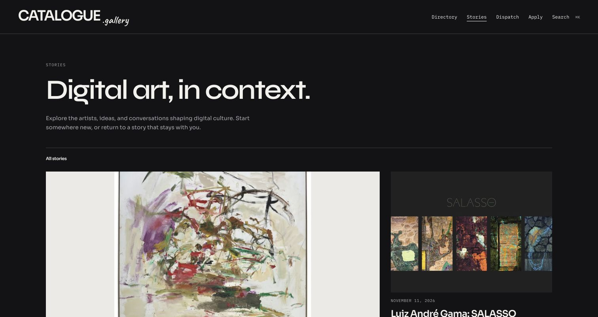
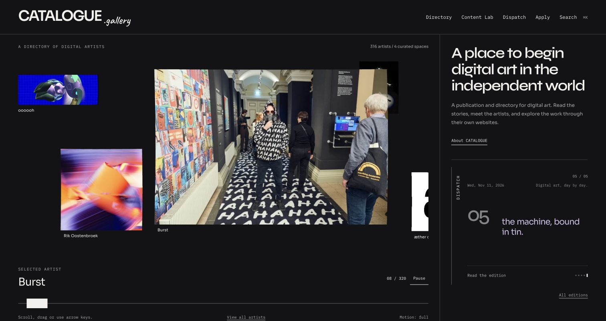
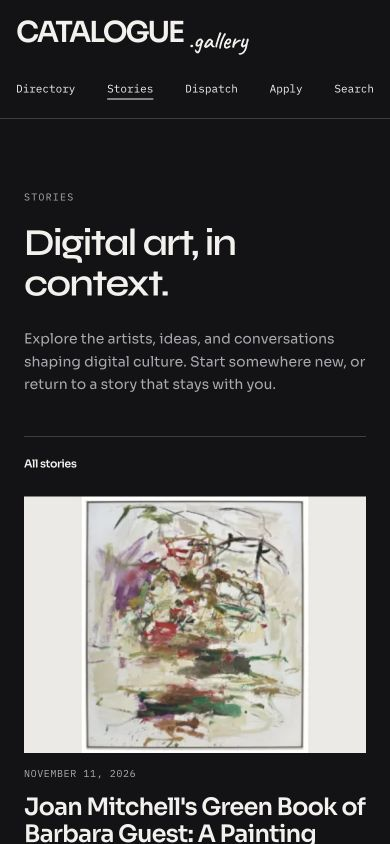

# CATALOGUE.gallery

[](https://securityscorecards.dev/viewer/?uri=github.com/byLemonhaze/catalogue.gallery) [](https://www.bestpractices.dev/projects/12104)

**Digital art. Independent worlds.**

CATALOGUE is a publication and discovery platform that takes visitors into artists’ and galleries’ own websites. Discover a practice through the moving Windows carousel, open a profile, then enter the artist’s world. Read longer editorial work in **Stories** and follow the daily news through **Dispatch**.

[Explore Catalogue](https://catalogue.gallery) · [Browse the directory](https://catalogue.gallery/artists/) · [Read Stories](https://catalogue.gallery/stories/) · [Daily Dispatch](https://catalogue.gallery/dispatch/)

## Catalogue 0.2

The second-generation experience brings together the Windows WebGL carousel, a dark-only visual system, the Constellation identity, editorial page transitions and a mobile-ready directory. Artist-owned websites remain at the centre of discovery.

- **Discover:** touch, wheel and keyboard browsing; directory search, sorting, Shuffle and grid/list views.
- **Enter:** profile previews reveal the artist’s website before entry; a compact movable exit keeps Catalogue within reach.
- **Read:** Stories and daily Dispatch editions, with the Counterpoint live transcript on the homepage.
- **Share:** server-rendered public pages, canonical URLs, permanent legacy redirects and audited social previews.

[0.2 release notes](docs/releases/v0.2.0.md) · [Latest published release](https://github.com/byLemonhaze/catalogue.gallery/releases/latest) · [Changelog](CHANGELOG.md)

## Experience in pictures

**Stories — desktop.** The current public editorial naming and dark visual system.



**Windows + Counterpoint — design checkpoint, 12 November.** The approved carousel and transcript direction. This capture predates the navigation rename from Content Lab to Stories; it is retained as design evidence, not a claim about today's live content.



**Stories — mobile, 390 px.** Real narrow-viewport capture from the navigation/sharing review.



These are actual review captures. Static images cannot demonstrate the warp, automatic profile reveal or page transitions: [try the live experience](https://catalogue.gallery), or inspect the [visual evidence index](docs/README.md#visual-evidence). A current motion recording remains a follow-up.

## Stack

- Frontend: React + TypeScript + Vite
- Content + review backend: Sanity Studio (`/studio`)
- Public API endpoints: Cloudflare Pages Functions (`/functions/api`)
- Email delivery: Resend
- Inbox/reply workflow: `apply@catalogue.gallery` Reply-To (CF Email Routing → ProtonMail)
- Stories: Sanity `post` documents (served at `/stories/:slug/`; legacy `/blog/` links redirect)

## Engineering Docs

Start with the [documentation index](docs/README.md), [current publishing guide](docs/EDITORIAL-PUBLISHING.md) and [documentation audit](docs/DOCUMENTATION-AUDIT-2026-11-12.md). Current operations, historical design evidence and future proposals are separated there.

- Architecture: [`docs/ARCHITECTURE.md`](./docs/ARCHITECTURE.md)
- API contract: [`docs/API.md`](./docs/API.md)
- Quality and verification policy: [`docs/QUALITY.md`](./docs/QUALITY.md)
- Deployment runbook: [`docs/DEPLOYMENT.md`](./docs/DEPLOYMENT.md)
- Redesign session trajectory, decisions and evidence: [`docs/SESSION-TRAJECTORY-2026-11-11.md`](./docs/SESSION-TRAJECTORY-2026-11-11.md)
- Mobile polish, before/after captures and device checks: [`docs/MOBILE-POLISH-2026-11-12.md`](./docs/MOBILE-POLISH-2026-11-12.md)
- Product roadmap notes: [`docs/ROADMAP.md`](./docs/ROADMAP.md)

## Dispatch design and session records

The homepage uses the approved Counterpoint Dispatch treatment: one vertical masthead, a neutral counter and lilac word reveals on the existing dark surface. Reduced motion keeps the full edition readable.

- [12 November session report and release checkpoint](docs/SESSION-REPORT-2026-11-12.md)
- [Twelve design studies and decision notebook](docs/DISPATCH-DESIGN-STUDIES-2026-11-12.md)
- [Dispatch publishing contract](docs/DISPATCH-PUBLISHING.md)
- [Constellation logo masters and exports](docs/BRAND-CONSTELLATION.md)
- [Site-wide motion, Stories migration and sharing checks](docs/NAVIGATION-AND-SHARING-2026-11-12.md)
- [Stories/Constellation release preparation](docs/STORIES-CONSTELLATION-RELEASE.md)

For local review, start Vite and open `/design/dispatch/` (01–06) or `/design/dispatch-02/` (07–12). These entries are preserved for design history and are excluded from the production application build.

## Security

- Security policy and reporting process: [`SECURITY.md`](./SECURITY.md)
- Please report vulnerabilities privately through GitHub private vulnerability reporting when possible.

## Reporting and Collaboration

- Public bug reports: [GitHub Issues](https://github.com/byLemonhaze/catalogue.gallery/issues)
- New issue form: [Report a bug or request a feature](https://github.com/byLemonhaze/catalogue.gallery/issues/new/choose)
- Private vulnerability reporting: [GitHub Security Advisories](https://github.com/byLemonhaze/catalogue.gallery/security/advisories/new)
- Contribution guide: [`CONTRIBUTING.md`](./CONTRIBUTING.md)

Repository documentation, issues, and pull request discussions are maintained in English so bug reports, review notes, and operational guidance stay searchable and reusable.

## Releases and Versioning

- Public releases are published on [GitHub Releases](https://github.com/byLemonhaze/catalogue.gallery/releases).
- Repository releases use [Semantic Versioning](https://semver.org/). `v0.2.0` marks the second-generation product; the historical `v0.1.x` releases remain unchanged.
- A GitHub Release is a tagged source milestone, separate from a Cloudflare deployment. See the [release procedure](docs/RELEASING.md) for keeping both aligned.
- Human-readable release notes are tracked in [`CHANGELOG.md`](./CHANGELOG.md).

## Local Development

1. Install dependencies:
   - `npm install`
   - `(cd studio && npm install)`
2. Create local env file:
   - `cp .env.example .env.local`
3. Run app:
   - `npm run dev`
4. Run Sanity Studio:
   - `(cd studio && npm run dev)`

## Environment Variables

Use `.env.local` for local secrets. Never commit `.env` or `.env.local`.

App/server configuration (see [deployment](docs/DEPLOYMENT.md) for environment-specific setup; these are separate from external bot credentials):

- `VITE_SANITY_PROJECT_ID`
- `VITE_SANITY_DATASET`
- `SANITY_WRITE_TOKEN` (server-side write token for submit endpoint)
- `RESEND_API_KEY`
- `RESEND_FROM_EMAIL` (example: `CATALOGUE <apply@catalogue.gallery>`)
- `RESEND_REPLY_TO` (prefer `apply@catalogue.gallery`; CF Email Routing forwards to ProtonMail. Leave unset to use the same default in the webhook)
- `PUBLIC_BASE_URL` (example: `https://catalogue.gallery`)
- `VITE_CF_WEB_ANALYTICS_TOKEN` (optional; only needed for manual beacon mode)
- `WEBHOOK_SHARED_SECRET` (required; webhook requests are rejected without it)
- `EMAIL_ENCRYPTION_KEY` (32-byte base64 key used to encrypt contact emails at rest in D1; Sanity stores `contactId` only)
- `SANITY_PROJECT_ID` (optional server override)
- `SANITY_DATASET` (optional server override)

Cloudflare binding (not an env var):

- `CONTACTS_DB` (D1 binding used for private contact storage)

## Submission + Review Flow

1. User submits via `/submit`.
2. `POST /api/submit` creates a Sanity `artist` or `gallery` document with:
   - `status: "pending"`
   - stores email in private D1 and writes `contactId` to Sanity
3. You review in Sanity Studio:
   - pending list: `In Review (New)`
   - for fast workflow use document actions:
     - `Approve & Notify` (from pending)
     - `Decline & Notify` (from pending: pick rejection reason in the dialog, then publish)
   - declines require a `rejectionReasonCode` (and `rejectionReason` when reason is Other)
   - for approvals optionally add `approvalMessage`
4. Sanity webhook calls `POST /api/webhook`.
5. `/api/webhook` sends approval/decline email through Resend.

### Contact Email Privacy

- Recommended mode: keep applicant emails in private Cloudflare D1 (`submission_contacts`) and only store `contactId` in Sanity.
- Submit endpoint now requires `CONTACTS_DB`; new submissions fail closed if D1 binding is missing.
- Webhooks decrypt server-side only (requires `EMAIL_ENCRYPTION_KEY`).

### Cloudflare D1 Contact Store Setup

1. Create database:
   - `npx wrangler d1 create catalogue-private-contacts`
2. Add binding in `wrangler.toml` (replace `database_id`):
   - `[[d1_databases]]`
   - `binding = "CONTACTS_DB"`
   - `database_name = "catalogue-private-contacts"`
   - `database_id = "<your-database-id>"`
3. Apply both application/review migrations in order:
   - `npx wrangler d1 execute catalogue-private-contacts --remote --file=./migrations/001_submission_contacts.sql`
   - `npx wrangler d1 execute catalogue-private-contacts --remote --file=./migrations/002_contact_notifications.sql`
4. Deploy app again so Functions can use the binding.
5. Migrate old encrypted emails from Sanity into D1 and remove legacy `email` fields:
   - `cd studio && npm run migrate:contacts:d1`

## Editorial publishing

**External Grok bots → Sanity → Catalogue.** Stories uses Sanity `post` documents; daily Dispatch uses `dispatch` documents. Production Functions read published content at request time, so valid new editions and Stories appear without rebuilding the frontend. Allow for the five-minute public HTML cache and reload already-open tabs; the page does not continuously poll for editions.

The bots run outside this repository. Their scheduler, approval records and X publication ledger are separate operational concerns. The website supplies schemas and display surfaces. See the [current publishing guide](docs/EDITORIAL-PUBLISHING.md) for required fields, approval and timing rules, and [Dispatch's site-first publication contract](docs/DISPATCH-PUBLISHING.md).

The old in-repository Content Lab editor and its model integrations remain in source but are **not the current publishing workflow**. Their routes, dependencies and migration tools are documented in the [legacy inventory](docs/legacy/CONTENT-LAB.md). Do not run the old article migration as a routine content refresh.

## Resend + apply@ Reply-To (Recommended)

Use Resend to send mail, with Reply-To on `apply@catalogue.gallery` so inbound replies land via Cloudflare Email Routing:

1. In Resend:
   - verify `catalogue.gallery` domain with DNS records
   - set sender as `CATALOGUE <apply@catalogue.gallery>`
2. In Cloudflare Email Routing:
   - enable routing for `catalogue.gallery`
   - route `apply@catalogue.gallery` to your private shared inbox (destination stays in the Cloudflare dashboard only — never commit it)
3. In Cloudflare Pages env vars:
   - `RESEND_API_KEY`
   - `RESEND_FROM_EMAIL=CATALOGUE <apply@catalogue.gallery>`
   - `RESEND_REPLY_TO=apply@catalogue.gallery` (or clear the secret; webhook defaults to `apply@`). Do not set a personal mailbox as Reply-To.
4. In Sanity webhook settings:
   - URL: your deployed webhook endpoint
   - Trigger: document create/update for `artist` and `gallery`
   - Configure the shared secret header using `WEBHOOK_SHARED_SECRET`

This keeps deliverability high (Resend) while replies go to `apply@` and forward into ProtonMail.

## Testing

```bash
npm test          # Run once
npm test -- --run # Run once (CI)
npm run test:watch # Watch mode
npm run verify    # Lint + typecheck + tests
```

Coverage includes discovery gestures, profiles/world entry, directory/search, editorial data, navigation/redirects, application validation, embedding checks, metadata and sharing audits. Use the test runner's output for the current total; dated verification evidence is recorded in [Quality](docs/QUALITY.md) and session reports.

Verification policy, static analysis, and the new-functionality test policy are documented in [`docs/QUALITY.md`](./docs/QUALITY.md).

## Useful Scripts

- Build app: `npm run build`
- Audit generated share previews: `npm run audit:shares` (add `-- --remote` to check remote images)
- Move legacy encrypted contacts into D1: `cd studio && npm run migrate:contacts:d1`

## CI + Branch Protection

- CI runs lint, type check, tests, and build on pull requests to `main`.
- Branch protection is a GitHub repository setting (manual), not a code-delivered feature.
- Manual checklist is documented in [`docs/DEPLOYMENT.md`](./docs/DEPLOYMENT.md).

## Contributing and License

- Contribution guide: [`CONTRIBUTING.md`](./CONTRIBUTING.md)
- License: [`LICENSE`](./LICENSE) (MIT)
