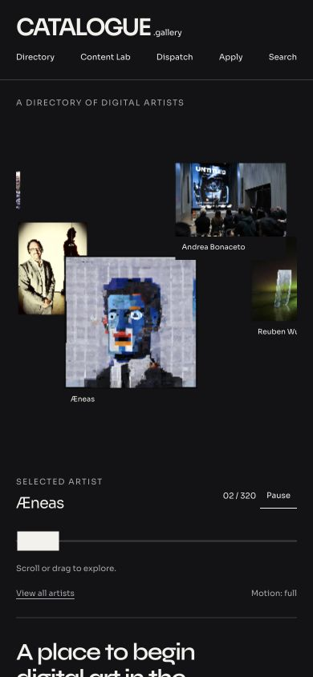
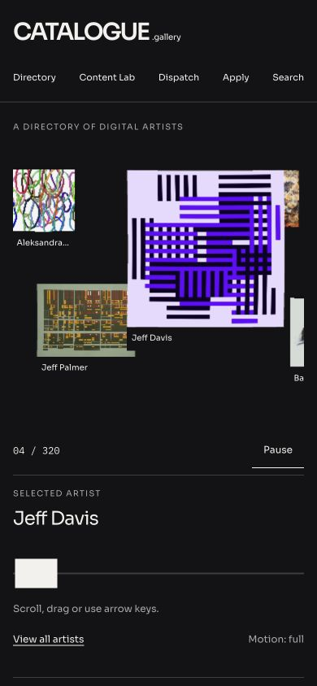
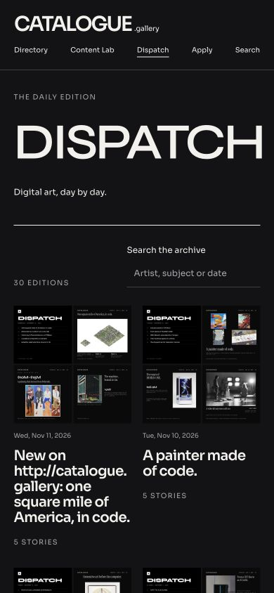
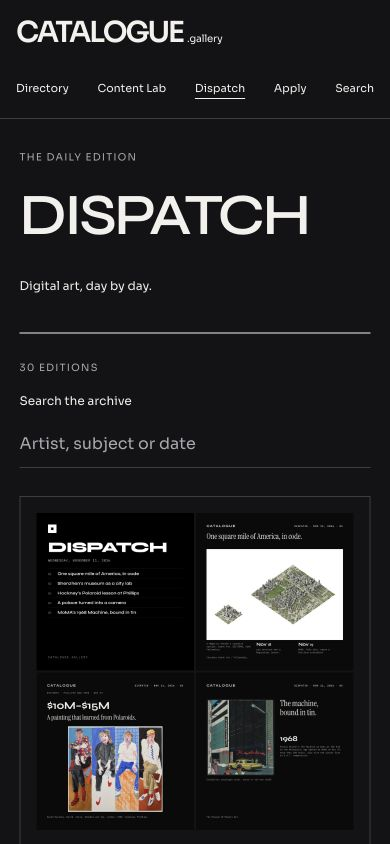
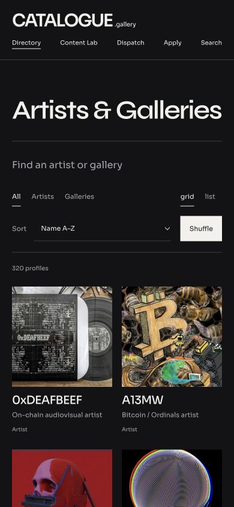
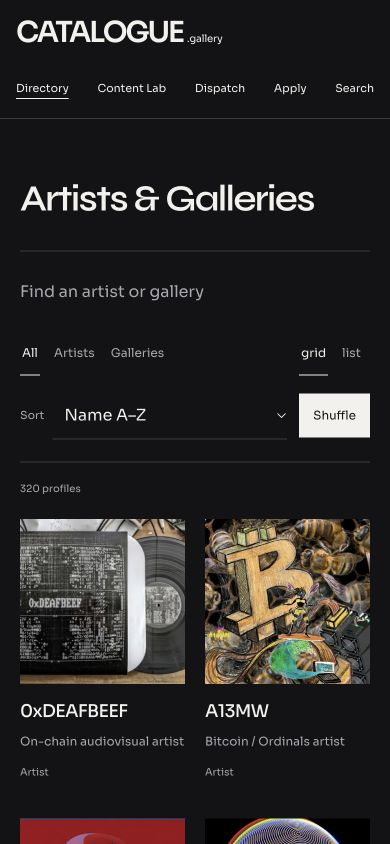

# Windows mobile polish — review record

12 November 2026 UTC (11 November in Montréal). Branch: `feat/mobile-polish`, based on the merged Windows release `90c1f888be96597be7aadcddc729380d1c488f96`.

## Scope and decisions

This pass strengthens the existing dark Windows system. It retains the WebGL carousel, original image proportions, profile-before-world navigation, dark-only palette, Syne/Sora/IBM Plex Mono families and historical DISPATCH content. There are no CMS, bot, dependency or deployment changes.

The optional handwritten `.gallery` experiment was not attempted. The existing lockup remains readable at 360 px; this pass prioritizes navigation and content legibility.

## Implemented

- `viewport-fit=cover` and shared top/bottom/side safe-area variables. Mobile main content has `64px + safe-area-inset-bottom` end padding; document and dialogs have scroll padding. Header, modal bounds, world exit and world loading states account for insets. World height follows the dynamic viewport (`dvh`), while carousel height uses the stable small viewport (`svh`).
- Mobile header puts the wordmark above wrapping navigation. All five links remain visible, with at least 44 px vertical targets and 16 px side clearance before device insets.
- DISPATCH archive becomes one column below 600 px, with card borders, 16 px image padding, larger dates/headlines and uncropped contained imagery. At larger mobile widths it retains two columns. The plates and historical text are untouched.
- Directory retains its two-column card model with more row spacing and name/subtitle line height. At 360 px the filter, sort/Shuffle and grid/list controls use separate rows. Search fields and selects use 16 px text with at least 48 px height.
- Carousel position/total and Pause/Resume occupy their own row above the selected name. The stage is shorter on phones so the scrubber, instructions and View all artists fit more readily. Pointer instructions mention arrow keys; touch devices receive sideways-swipe and page-scroll guidance. Horizontal capture requires clear intent; vertical/ambiguous gestures yield to page scrolling. Existing `pan-y pinch-zoom`, wheel handling and keyboard stepping remain.
- Profiles have a larger close target, bounded scrollable dialog, contained image and 56 px Enter world target. Known external-only sites show a quiet explanation before entry. World exits are 52 px tall and positioned above the bottom inset, preserving artist-specific exit placement.
- Global search now includes DISPATCH dates, headlines and body text, alongside artist/gallery profiles and stories. Profile results still open the intermediate profile; stories and editions open their reader. A shared predicate keeps archive/global edition searches consistent. The extra live DISPATCH request is deferred until search opens.
- Quiet no-result messages with reset controls in the directory/archive; a clearer first-load carousel message. One-line descriptions distinguish daily DISPATCH news from Content Lab context.
- Apply inputs, controls and surfaces follow the dark system; mobile input type sizes avoid the usual small-input zoom trigger. Article/About headings gain breathing room.

## Before/after evidence — 390 × 844

These are actual Chrome responsive viewport captures of the local application, not device mockups. The carousel is live and shuffled, so the selected artwork differs between captures. This is a visual review record, not a pixel-diff test or a continuous video recording.

| Page | Before | After |
| --- | --- | --- |
| Homepage |  |  |
| About |  |  |
| DISPATCH archive |  |  |
| Directory |  |  |

The complete archive card, including its date and title, appears in the [scrolled card capture](review/mobile-polish/after-dispatch-card-390.png). A single card can extend beyond one viewport and remains part of normal page scrolling.

### 360 × 800 checks

[Homepage](review/mobile-polish/after-home-360.png) · [Directory](review/mobile-polish/after-directory-360.png) · [DISPATCH](review/mobile-polish/after-dispatch-360.png) · [About](review/mobile-polish/after-about-360.png)

### Additional states

- [Long-name profile dialog](review/mobile-polish/after-profile-390.png): Armin Aschenbrenner fits, image is contained, Enter world is 56 px tall.
- [Blocked world](review/mobile-polish/after-world-blocked-390.png): exit control is 52 px tall, 20 px above the viewport bottom before a nonzero device inset.
- [DISPATCH date search](review/mobile-polish/after-search-390.png): selecting the result was verified to open `/dispatch/2026-11-11/`.
- [Apply introduction](review/mobile-polish/after-apply-390.png) and [form](review/mobile-polish/after-apply-form-390.png): dark fields and 48–50 px input heights. No application was submitted.
- [Article](review/mobile-polish/after-article-390.png), [article end](review/mobile-polish/after-article-bottom-390.png), [About end](review/mobile-polish/after-about-bottom-390.png): content can scroll clear of the bottom edge.

## Verification

| Check | Result |
| --- | --- |
| `npm run verify` | Passed: ESLint, TypeScript, 196 tests in 28 files |
| New regression coverage | 10 cases: all four search result types and routes, keyboard shortcut/focus, whitespace/no results, date/body matching without archive mutation, directory reset, blocked entry, gesture intent/click suppression, Pause/Resume and position |
| Client + SSR compilation | Passed with `npm run build --ignore-scripts`; repeated successfully during the full build attempt |
| Full `npm run build` | Postbuild blocked: `npx` could not resolve `registry.npmjs.org` to obtain `tsx`. SEO generation must run in a network-enabled environment before merge/deployment. |
| Existing bundle warning | Entry 607.17 kB (177.08 kB gzip), SSR 1,423.74 kB; large-chunk warning remains. No warning threshold was raised. |
| Responsive geometry | No horizontal document overflow on the reviewed homepage, directory, archive and About at target widths; article and Apply checked at 390 px |
| Phone controls | At 360 × 800, View all artists measured y=738–786; at 390 × 844, blocked-world exit measured y=772–824; actual device insets add clearance |
| Article end | At document bottom, computed main padding was 64 px with desktop safe-area values of zero |
| Git whitespace check | `git diff --check` passed |

## Remaining limitations and release checks

**Physical iOS Safari verification remains outstanding.** Desktop responsive Chrome does not emulate Safari's expanding address/toolbar, home indicator, virtual keyboard or actual touch arbitration. Screenshots prove responsive layout and end spacing; they do not prove that a real Safari toolbar never covers content. The viewport API did not change the desktop pointer capability, so captures show pointer instructions. Gesture direction/cancellation is covered by synthetic tests, not a physical phone session.

Before release, on iPhone Safari at both target sizes (or the closest available devices):

1. Expand/collapse the browser toolbar and scroll to the final links on About, archive, directory and an article. Check home-indicator clearance and landscape insets.
2. Start vertical, diagonal and horizontal gestures over carousel artwork; test pinch zoom, Pause/Resume, the scrubber and View all artists.
3. Open a long-name profile, enter a known blocked site, and exit. Confirm every control stays reachable with toolbar expanded and after orientation change.
4. Open search and Apply with the virtual keyboard visible; confirm focused inputs and modal close controls can be reached. Do not create a real application for layout testing.

On lower-powered devices, the existing WebGL image deformation and third-party artist websites remain the largest variable costs. Existing renderer pixel-ratio caps (1.75 for carousel, 1.5 for profile vortex), offscreen/hidden-page suspension and reduced-motion fallback remain in place. This pass does not claim measured FPS, battery use or performance on older hardware. Use Motion: reduced where needed; embedded artist sites remain outside CATALOGUE's rendering control. Known blocked-site indicators cover the existing explicit list, not every site that might change its embedding policy.

The existing dependency/security backlog and CSS duplication were not expanded into this mobile pass. Full build/CI and physical-device review remain release gates. No production deployment was performed.

## Handoff

Implementation, screenshots and this record are prepared locally. Shell GitHub DNS resolution is unavailable, so branch publication and PR creation need a network-enabled handoff. The exact PR description is in [MOBILE-POLISH-PR.md](MOBILE-POLISH-PR.md). After the branch is pushed, open the PR against `main`, run CI and attach real-device evidence if available. Do not treat a successful source push as a Cloudflare deployment.
