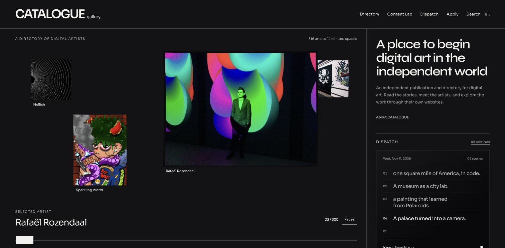
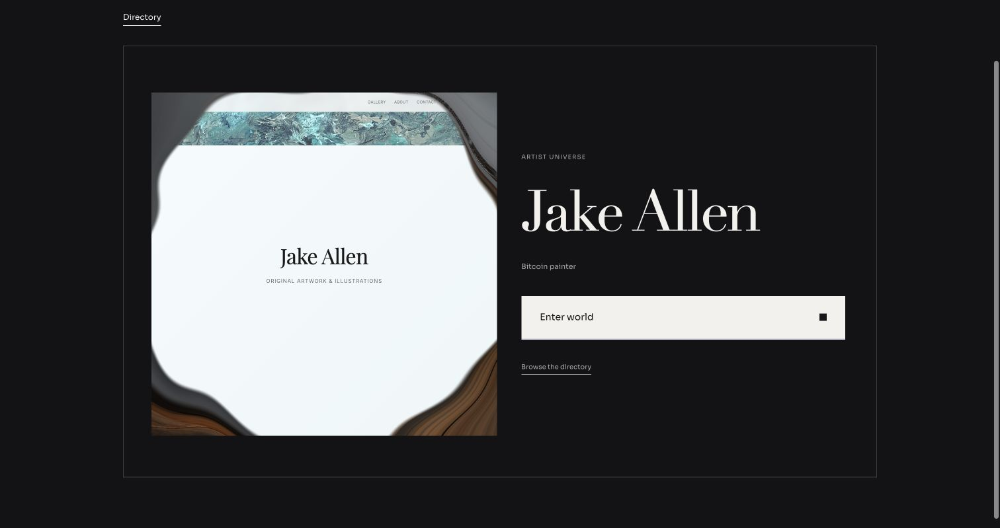

# CATALOGUE redesign: session trajectory and release record

Session: 11 November 2026, Montréal time, continuing into 12 November UTC. Owner and creative direction: Frédérick Nathaniel St-Louis / Lemonhaze. Implementation: Codex, directed through iterative local browser review.

This is the retrospective record requested by the owner before release. It reconstructs decisions, experiments, corrections, implementation and verification from the conversation, repository history, existing review notes and saved screenshots. It is **not a verbatim chat export or a continuous screen recording**: no continuous video was recorded, and the original ten-mockup set is not preserved among the linked review captures. Early concept stages below are conversation-derived; implementation and verification claims are grounded in the repository and review record. Exact times are not inferred for individual feedback rounds.

## Final direction at this checkpoint

CATALOGUE remains an independent publication and directory that leads visitors into artist-owned websites. The selected Windows discovery system combines varied original image proportions, a physically responsive WebGL carousel, a profile before world entry, and a daily DISPATCH transcript. The final interface is dark-only, with self-hosted **Syne for headings and Sora for reading and controls**. Original editorial copy and artwork are preserved except for changes explicitly requested by the owner.

The lighter profile interaction evolved into a centre-out vortex revealing a miniature of the real artist website. DISPATCH evolved in the opposite direction: its liquid treatment was removed in favour of a quiet, square black surface with live-typed headlines. These are intentionally different interactions within the same visual system.

## Chronological decision record

### 1. Email setup was cancelled; product design became the scope

The initial request concerned onboarding email, with `contact@catalogue.gallery` proposed. The owner recalled that the existing `apply@catalogue.gallery` pipeline was satisfactory and cancelled that work. Email configuration was not part of this release.

The replacement request was to retain current content while replacing a generic, template-like UI with distinctive, immersive design. The owner requested research and three directions, with [Palmer Dinnerware](https://www.palmer-dinnerware.com/) as an interaction reference. After rejecting the first output, the owner requested ten different mockups.

### 2. Ten directions narrowed to three interactive demos

The owner selected **01 Horizon, 10 Window and 08 Room** for interactive exploration and requested roughly three times as many artists so scrolling could be tested meaningfully.

| Direction | Expected interaction | Outcome |
| --- | --- | --- |
| 01 Horizon | Depth from foreground left toward background right, with a media sidebar | Explored; not the final full-site direction |
| 10 Window | A carousel whose artwork windows dynamically expand and shrink | Selected for the full site |
| 08 Room | A continuous slider rather than only arrows | Explored; not the final full-site direction |

The profile card before entering an artist's world was retained. Short biographies of three to five lines were assigned to a separate future effort; this release does not invent them. The full-site brief also requested SEO/navigation-flow work and a clearer purpose for the landing sidebar.

### 3. Motion became the defining quality requirement

[Unseen Projects](https://unseen.co/projects/) became the principal motion reference. The brief called for actual image bending with velocity, cursor deformation, micro-parallax and tactile light. The implementation uses a custom WebGL mesh and shaders: an interpretation of the reference, not Unseen's source or a claim to reproduce its exact stack. The stage uses damped motion; whole-page smooth-scroll hijacking was not added.

The associated corrections were specific:

- Wheel input over artwork rotates the carousel; Ctrl-wheel browser zoom remains available.
- Automatic movement makes interaction discoverable. Manual manipulation pauses it, inactivity resumes it, and explicit Pause stays paused until Resume.
- A solid end-cap scrubber replaces weak arrow buttons. Keyboard arrows subsequently received whole-artist stepping.
- Background captions disappear as a unit when occluded, fixing the next artist's name overlapping foreground artwork.
- Artwork keeps its original aspect ratio inside the changing windows. Portrait, square and panoramic works remain varied and uncropped.
- Thin decorative link arrows were removed. Underlines, contrast and the rotating square provide cues.

### 4. Content hierarchy and profile flow were corrected

Stories, articles, notes and interviews became one **All stories** feed. Interview labels remain. The redundant editor shelf and duplicated sidebar Content Lab list were removed.

The sidebar became the introduction plus DISPATCH. The requested tagline was retained: “A place to begin digital art in the independent world.” The original supporting paragraph was restored. “Across mediums, platforms, and chains.” was explicitly removed. Production headings/copy were restored where earlier iterations had rewritten them without approval.

The flow became: select an artist to open the profile; select its image, card or **Enter world** to enter; Exit world returns to the profile; closing the profile restores discovery and focus. The duplicate **Open official website** card link was removed. Close and explicit links retain their own actions; text selection does not navigate. Direct profile URLs remain full pages, while discovery opens the same profile in a native dialog.

### 5. Directory and DISPATCH became complete browsing surfaces

The directory gained A–Z, Z–A, recently added and shuffled ordering, explicit reshuffle, and grid/list continuity. The redundant Directory heading above Artists & Galleries was removed. Shuffle order survives filtering and profile open/close within a visit.

The owner requested historical DISPATCH editions from **@CatalogueART**, every edition image, and future **Sanity live first, X second** publication. Recovered evidence contains 35 daily editions and one weekly recap. The five cover-only daily editions dated 6–10 October were removed from display at the owner's request; their source evidence remains preserved.

The bundled archive contains **30 daily editions, 164 stories and 120 images**. All recovered media appear in issue spreads and an accessible viewer. The verified 11 November plates also accompany stories 01, 03 and 05; other historical plates are not assigned to stories by guesswork. Archive thumbnails combine the text cover at top left with three plates in a 2×2 composition. The homepage initially shared this treatment, then moved to the transcript below. Original plates remain unchanged and may differ typographically from the new site.

The schema, draft-only backfill tool and publication contract are implemented. **No live Sanity import/publication, X post or external bot reconfiguration was performed.** See [DISPATCH publishing](DISPATCH-PUBLISHING.md) for provenance, ownership and remaining work.

### 6. The large landing gap was a layout defect

The owner initially felt the introduction had too much text, then clarified that the main issue was the empty area above the left directory label/count. The left column had been vertically centred against the taller sidebar. Top-aligning it removed the unintended gap. The owner then requested the supporting paragraph back.

This distinction matters for future revisions: diagnose spatial allocation before deleting useful content. [The balanced landing capture](review/landing-balanced.png) records this stage, not final typography.

### 7. Typography and theme experiments were narrowed explicitly

| Experiment | Feedback / outcome | Final rule |
| --- | --- | --- |
| System Didot/Bodoni-style display serif, Sora and mono controls | Competing typography; tagline lacked confidence | Remove the system-serif trial |
| Light + Night + Electric selector | Night useful; Electric did not achieve liquid chrome | Electric revised, then rejected |
| WebGL chrome/iridescent Electric | Still not the desired direction | Remove entirely, not a hidden option |
| Light mode | Owner subsequently requested dark-only | Remove picker and preference boot script |
| Syne headings + Sora reading/UI | Final audit using existing self-hosted fonts | Apply across site-owned surfaces |

Apfel Grotezk and Le Murmure were considered, but no external font package was installed/bundled. The owner also rejected heavy square focus decoration around pointer interactions. Pointer rings were removed; keyboard focus remains visible through an underline. This was a styling correction, not removal of keyboard access.

### 8. Long names required fitting, not arbitrary line breaks

Armin Aschenbrenner exposed the profile heading problem: the surname broke mid-word. Names now measure available width and fit on one line where possible. Exceptionally long names may wrap at whole-word boundaries, never within a surname. Accessible names remain complete.

The [name-fit capture](review/profile-name-fit.png) uses earlier serif typography. Final Syne was rechecked on desktop. The older mobile check is not final mobile approval of the changed face.

### 9. Landing DISPATCH evolved into a live transcript

The owner wanted a tactile, clickable black surface showing the day's news, with the feeling of a transcript/computer readout but without a novelty retro font. The successive decisions were:

1. Replace the homepage collage with a black broadcast surface.
2. Remove rounded corners and floating shadow; use straight Catalogue edges.
3. Show **all** daily headlines instead of a lone cycling headline.
4. Type character by character, retain completed rows, pause on the complete edition, then repeat.
5. Remove liquid sheen, pointer tilt and scanlines after reconsideration. Retain only a faint gradient on black.

The final transcript uses actual edition headlines, reserved row heights, a static full accessible description and reduced-motion presentation. It pauses offscreen/when hidden; hover/focus holds the completed bulletin. It links to the full edition, does not rewrite source content, and does not announce every character to screen readers.

### 10. Profile motion evolved into a portal preview

The owner first wanted the profile to share the carousel's tactile quality, then found profile warping too intense. The intermediate solution was a quiet image lift coordinated with the **rotating Enter world square**.

The later specific request was to reveal the real website beneath the image on hover, “ripping the image opening like a vortex,” with Oncyber as a conceptual reference. This superseded the earlier no-preview behaviour without restoring continuous carousel-style warping.

The preview intent-loads a non-interactive miniature HTTPS iframe. A WebGL spiral aperture twists the artwork outward from its centre; leaving reverses it and releases the iframe. Clicking still enters the normal world route. Jake Allen's actual site was verified in the preview and full world.

Known external-only profiles keep their artwork. Timeout/network failures retain the image. Reduced motion reveals immediately; unavailable WebGL/texture access uses a fade. Cross-origin frame policies cannot always be diagnosed from load events, so the known-blocked list remains necessary. The preview receives no camera, microphone, forms, popup or autoplay permissions.

### 11. Final branding audit covered the wider site

The owner requested a full consistency pass before shipping. Desktop coverage included landing, directory, artist/gallery profiles, search, application including lower form, About/legal, Content Lab archive/reader, DISPATCH archive/issue/viewer, editor entrance, world blocked state and missing-page state.

Corrections included consistent dark surfaces and type roles, readable Apply/editor contrast, removal of a stray article-reader font fallback, a corrected broad background selector, matching world loading/exit/fallback controls, and a native legal dialog with Escape, focus containment and restoration. Artist-owned iframe contents were not restyled.

A production defect was also caught: the vortex requested a bounded 1200px image accepted by development but missing from the production proxy allowlist. The production endpoint and regression coverage were corrected.

### 12. Release authorization and documentation request

The owner explicitly authorized commit, push and deployment after review, then repeated that instruction. Application changes were committed as `70c672b`. The owner completed the network-dependent build and branch push from their terminal after the agent shell could not resolve external hosts.

[PR #52](https://github.com/byLemonhaze/catalogue.gallery/pull/52) was opened against `main`. Before release completion, the owner requested this full trajectory in GitHub. This documentation is part of the release branch and linked from the README.

## Implementation contracts for future contributors

| Area | Preserve |
| --- | --- |
| Carousel | Actual mesh deformation, original proportions, occlusion-safe captions, wheel/zoom distinction, touch vertical scrolling, explicit pause, reduced motion |
| Profile | Profile first/world second; measured complete names; rotating square; selection-safe card entry; explicit close/link actions |
| Vortex | Real miniature website, intent load, reversible centre-out reveal, image fallback, iframe/GPU cleanup, blocked-site exclusions |
| Directory | Stable shuffle within a visit, reshuffle, sort/search/filter and grid/list continuity |
| Content Lab | One feed, interview labels, original copy, consistent reader typography |
| Homepage DISPATCH | All daily headlines typed on square black/faint gradient; no liquid or tilt |
| Archive DISPATCH | Four-image thumbnails, all issue media, original plates, preserved provenance |
| Theme/type | Dark initial paint; self-hosted Syne/Sora; no Electric, Light selector or system-serif trial |
| World shell | Matching loading/exit/fallback; return to profile; artist websites unchanged |
| SEO | Canonical profiles, noindex nested worlds, rendered public text, dated DISPATCH metadata, sitemap/route inventory |

See [Windows implementation notes](WINDOWS-REDESIGN.md), [architecture](ARCHITECTURE.md), [SEO](SEO.md) and [deployment](DEPLOYMENT.md). Earlier Windows entries are historical stages; its final audit and this record supersede rejected experiments.

## Verification and limits

| Check | Observed result | Limit |
| --- | --- | --- |
| ESLint / TypeScript | Passed at `70c672b` | Documentation follow-up does not change runtime code |
| Tests | 186 passed across 27 suites | Not a substitute for real-device visual/motion review |
| Full production build | Owner completed `npm run build`; output inspected | Agent shell initially could not fetch the network-dependent runner |
| Generated output | 503 route pages, 320 profiles, 147 articles, 30 DISPATCH editions; bundled asset references present | Local output is not production HTTP/edge validation |
| Client / server bundles | Both produced, including SSR renderer | Main entry about 605 kB / 177 kB gzip; Vite size warning remains |
| Desktop | Surfaces listed above reviewed | Authenticated editorial publishing not exercised |
| Mobile | Earlier 390px interaction/name checks recorded | Final-font viewport override did not apply; fresh mobile sign-off outstanding |
| CodeFactor, initial PR head | 46 findings: 42 duplicate-selector warnings, four complexity notices | Maintainability debt; do not describe all GitHub checks as green |
| Required GitHub CI | Lint, type check, test and build passed on initial PR head `70c672b` | Recheck after the documentation push |
| Production | Pending at documentation checkpoint | No release claim before observed upload/live checks |

## Screenshot and source index

Saved captures are not a complete frame-by-frame record. Rejected and superseded stages are labelled explicitly.

| Evidence | Stage |
| --- | --- |
| [dark-home-transcript.png](review/dark-home-transcript.png) | Final desktop dark landing/transcript |
| [profile-vortex.png](review/profile-vortex.png) | Verified portal, earlier serif |
| [profile-name-fit.png](review/profile-name-fit.png) | Name-fit correction, earlier type |
| [profile-card.jpg](review/profile-card.jpg) | Earlier profile composition |
| [world-controls.png](review/world-controls.png) | World shell before final type audit |
| [dispatch-archive-collages.png](review/dispatch-archive-collages.png) | Archive 2×2 thumbnails |
| [dispatch-image-spread.png](review/dispatch-image-spread.png) | Full edition media |
| [landing-dispatch-collage.png](review/landing-dispatch-collage.png) | Superseded homepage collage |
| [landing-balanced.png](review/landing-balanced.png) | Gap/density correction |
| [dispatch-bulletin.png](review/dispatch-bulletin.png) | Earlier broadcast, later simplified |
| [theme-night.png](review/theme-night.png) | Early Night before dark-only audit |
| [theme-electric.png](review/theme-electric.png) | Rejected Electric |
| [theme-liquid-chrome.png](review/theme-liquid-chrome.png) | Rejected chrome revision |
| [release-pr-checkpoint.png](review/release-pr-checkpoint.png) | PR release checkpoint before documentation push/merge |

[DISPATCH source evidence](review/dispatch-x-source.json) preserves public posts/media, not private chat history. Credentials, private biographies and unrelated account information are excluded from this record.

## Release ledger

| Milestone | Evidence / status |
| --- | --- |
| Base | [`bac7107`](https://github.com/byLemonhaze/catalogue.gallery/commit/bac71079e582991fbb3e0f165f4018df69cea31a), prior SEO/rendering release |
| Initial Windows | [`3bd9f34`](https://github.com/byLemonhaze/catalogue.gallery/commit/3bd9f344755d9ad6a8d3f3cef1f25dc79bdfe2ef) |
| Final application | [`70c672b`](https://github.com/byLemonhaze/catalogue.gallery/commit/70c672b566570fb092198c3edd61939c8252d7bd) |
| Branch / review | `feat/windows-redesign`; [PR #52](https://github.com/byLemonhaze/catalogue.gallery/pull/52), open at checkpoint |
| Build / branch push | Completed in owner's terminal; local output and remote-tracking state inspected |
| Session record | Documentation follow-up; exact commit available in this file's Git history |
| Required CI / merge | Required build check passed on `70c672b`; merge still pending. Recheck the documentation head. |
| Cloudflare | Separate direct upload: project `catalogue`, production branch `production`; merge alone does not deploy |
| Deployment ID / live verification | Not yet observed at this checkpoint |

Shell GitHub/Cloudflare DNS failures were environment limitations, not evidence of invalid credentials. Browser access worked for PR review. The deployment runbook governs the final build/upload sequence. Append the merged SHA, deployment ID/URL and actual live checks when observed; do not retroactively mark unobserved actions complete.

## Remaining work and boundaries

- Complete the release ledger with merge/deployment/live verification evidence.
- Fresh final-font mobile review and physical touch/lower-powered GPU motion checks.
- Consolidate repeated CSS selectors and flagged complexity in a separately verified cleanup; assess the entry-bundle warning.
- Separately review/deploy the Sanity schema, historical draft import and source enrichment. Bundled editions remain fallback until migration is completed.
- Integrate and verify the existing DISPATCH bot's site-first contract separately; do not create a second scheduler.
- Add reviewed short biographies from the separate biography effort without exposing internal research.
- Update original DISPATCH plates only when the owner supplies/approves that work.
- Keep the email pipeline and lemonhaze.com outside this release.

For future sessions, append dated decisions and evidence as work happens. Preserve rejected directions with explicit labels. Capture screenshots or video prospectively instead of implying a continuous recording exists retrospectively.

## 12 November 2026 UTC — mobile follow-up

The owner requested a focused mobile refinement of the merged Windows system at 390 × 844 and 360 × 800, with a PR and before/after evidence. The work adds safe-area handling, larger controls, a single-column phone DISPATCH archive, directory spacing, clearer carousel intent/position, blocked-site expectations and DISPATCH in global search. Dark-only branding, fonts, WebGL and profile-before-world navigation remain intact. The optional handwritten logo experiment was deferred.

The [mobile review record](MOBILE-POLISH-2026-11-12.md) preserves the screenshots, implementation decisions, 196 passing tests, build/postbuild distinction, physical-device limitations and publication handoff. This follow-up is not a deployment. Its final push/PR status must be appended when observed.
