# Discover a practice. Enter its world.

[Explore Catalogue](https://catalogue.gallery) · [Project README](../../README.md) · [Documentation index](../README.md)

Catalogue connects three experiences: discovering an artist, entering their own website, and reading the stories around their practice. This tour follows that journey across desktop and mobile. Dark surfaces and shared typography connect the pages; the artists' images and websites retain their own identities.

These are existing November review captures, selected for this tour on 12 November 2026. Several show the former Content Lab navigation label. The current public name is **Stories**. See the [capture record](#capture-record) for provenance and limits.

## Discover: Windows and the daily transcript

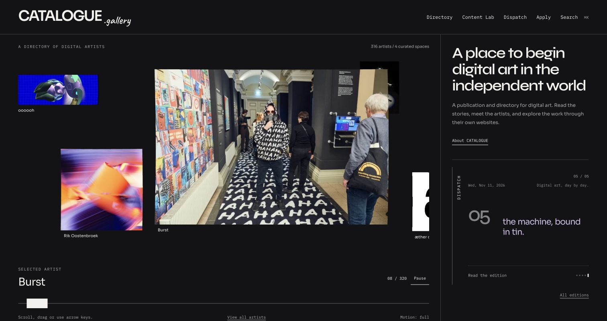

The Windows carousel gives each artist image its own proportions and position in depth. Touch, wheel and keyboard input move through the selection; pause and the scrubber provide direct control. The right column introduces Catalogue and carries Counterpoint, a sequence of daily headlines revealed in lilac text on a neutral dark surface.

This still shows the composition. Velocity-driven deformation, settling and headline timing need to be experienced on the [live homepage](https://catalogue.gallery).

## Meet: the profile before the world

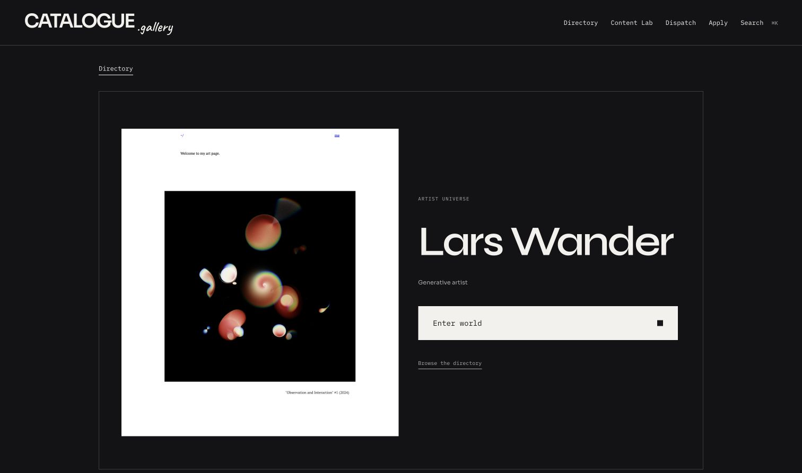

Opening an artist first presents a profile. The artwork is shown immediately; an eligible HTTPS website preview then loads automatically. Its iframe load event starts the reveal, without waiting for hover. The preview remains noninteractive, so clicking the image or **Enter world** deliberately enters the full site.

The screenshot is the revealed endpoint, not a recording of the vortex. Reduced motion skips the tear. Cross-origin iframe loading cannot guarantee that every external app has finished rendering or reliably detect every embedding restriction.

## Find: directory and unified search

| Browse and reorder | Search across the platform |
| --- | --- |
| 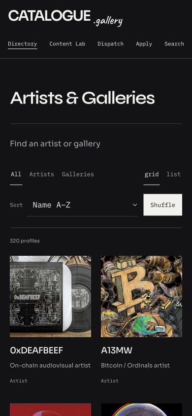 | 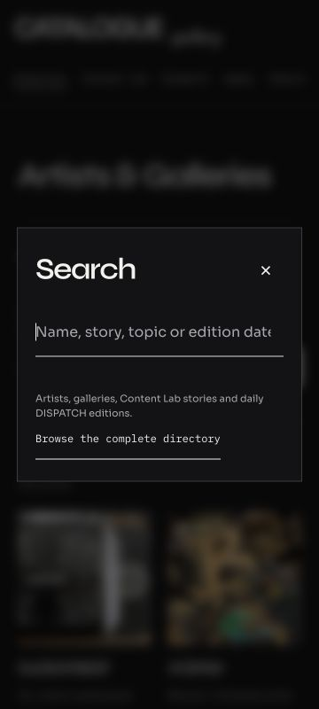 |

The directory supports alphabetical order, recent additions, Shuffle and grid/list views. Unified search covers artists, galleries, Stories and Dispatch editions, opening their corresponding surfaces. These narrow captures document the controls and search entry state; the search's old Content Lab helper text predates the Stories rename.

## Read: Stories archive and article

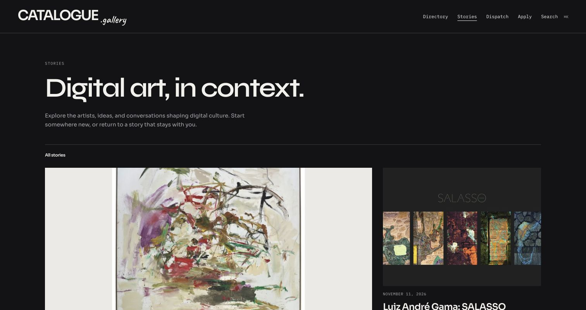

Stories is the longer editorial layer. The archive foregrounds images and titles; the reader gives the headline, introduction and article room to breathe. Public article addresses use `/stories/:slug/`; old `/blog/` links redirect permanently.

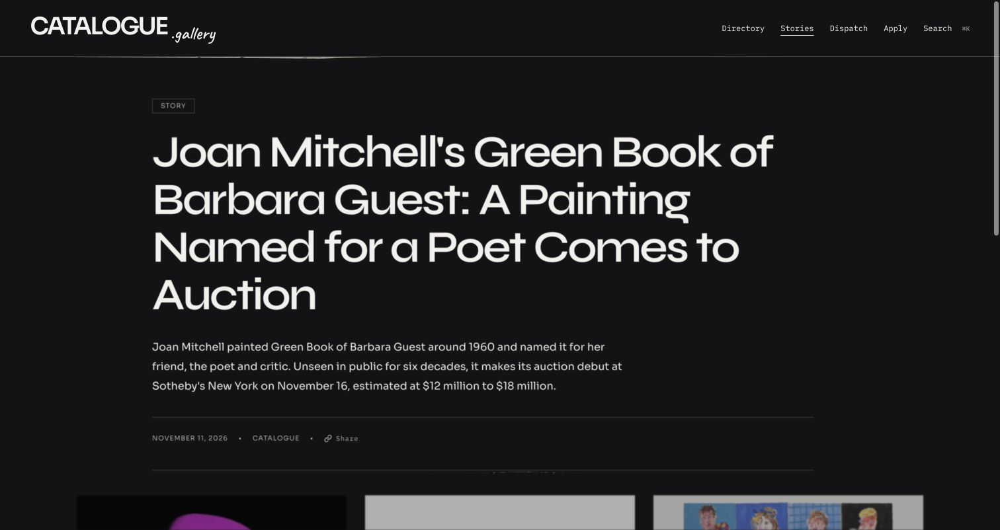

This reader capture was taken during the opening-transition review. A static frame does not establish the smoothness or duration of the transition.

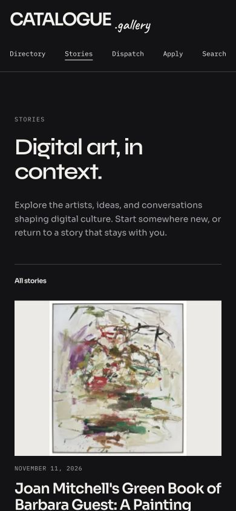

On mobile, the same hierarchy becomes a single reading column. The archive and reader captures in this section use the current Stories naming.

## Follow: Dispatch editions and their archive

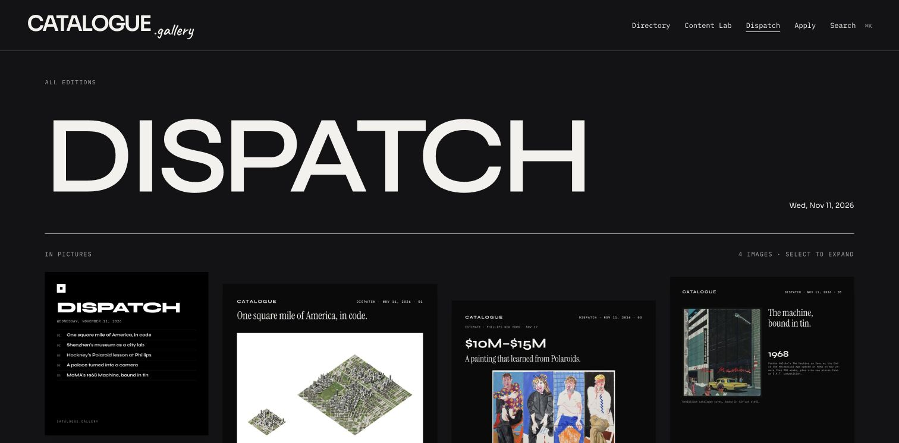

Dispatch collects the day's news into a dated edition. Its archive preserves the original plates; Counterpoint is the homepage invitation into that material. The archive collage remains part of the edition-card treatment, even though it was replaced by the transcript on the landing page.

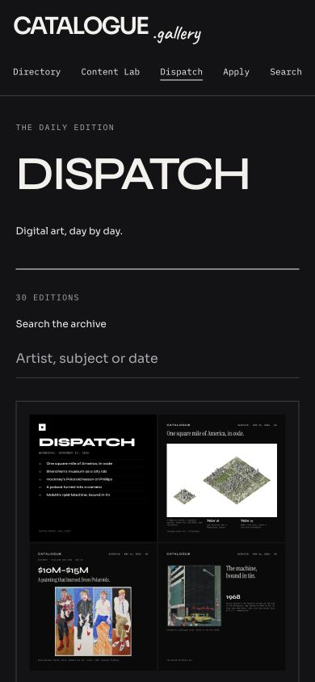

New published Sanity editions are read at request time, without a frontend rebuild. Cache propagation and already-open tabs still matter. [Current publishing guide](../EDITORIAL-PUBLISHING.md) explains that contract and the external bots' separate operational responsibilities.

## Enter and return: a small control, a clear fallback

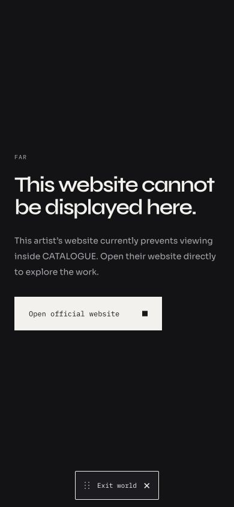

The compact exit can be repositioned so it does not obscure an artist site's navigation. This capture shows a **known blocked-embed fallback**, not a successful embedded website. The visitor can open the official site or return to Catalogue. A current recording of a successful world visit, repositioning and return remains to be captured.

## Understand and join: About and Apply

| About | Apply |
| --- | --- |
| 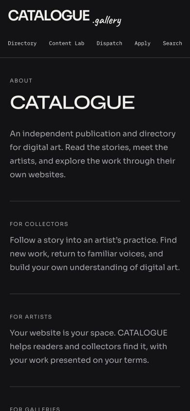 | 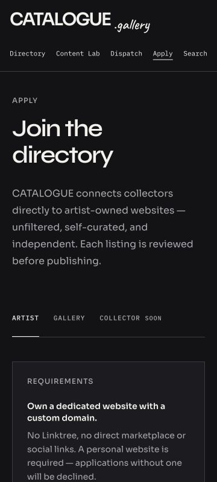 |

About explains the artist-owned website model. Apply turns that principle into listing requirements and a reviewed submission flow. These screenshots show the introduction and requirements, not a submitted application or proof of email delivery.

## Design and engineering evidence

| Visible behavior | Implementation | Regression coverage |
| --- | --- | --- |
| Windows browsing, image deformation and gesture intent | [Carousel](../../src/components/WindowsCarousel.tsx) | [Motion](../../src/__tests__/windowsMotion.test.ts), [gestures](../../src/__tests__/carouselGesture.test.ts) |
| Automatic website preview and profile-first entry | [Profile surface](../../src/components/ProfileSurface.tsx), [vortex](../../src/lib/profileVortex.ts) | [Profile surface tests](../../src/__tests__/profileSurface.test.tsx) |
| Compact movable world exit and blocked states | [Exit control](../../src/components/WorldExitControl.tsx), [world frame](../../src/pages/ArtistFrame.tsx) | [Exit control tests](../../src/__tests__/WorldExitControl.test.tsx), [frame tests](../../src/__tests__/ArtistFrame.test.tsx) |
| Daily headline sequence and motion alternatives | [Counterpoint](../../src/components/DispatchSignal.tsx) | [Transcript tests](../../src/__tests__/dispatchSignal.test.tsx) |
| Search, directory controls and narrow layouts | [Search](../../src/components/GlobalSearch.tsx) | [Mobile interaction tests](../../src/__tests__/mobilePolish.test.tsx), [directory ordering](../../src/__tests__/directoryOrder.test.ts) |
| Stories navigation, redirects and sharing | [Site link](../../src/components/SiteLink.tsx), [reader](../../src/components/ArticleView.tsx) | [Navigation tests](../../src/__tests__/siteNavigation.test.tsx), [share audit tests](../../src/__tests__/shareAudit.test.ts) |
| Reviewed artist/gallery applications | [Apply](../../src/pages/SubmitArtist.tsx) | [Form tests](../../src/__tests__/SubmitArtist.test.tsx), [submission API tests](../../src/__tests__/submitApi.test.ts) |

Test references identify covered behavior; they are not a claim of exhaustive device, accessibility or performance certification. [Quality and verification](../QUALITY.md) records the checks and their limits.

## Capture record

The tour reuses **12 unmodified captures** already tracked in the repository. It adds no simulated product screens, recreated UI or generated artwork. Review captures came from local browser sessions; none is represented here as a fresh production screenshot. The source reports preserve their original validation and release status. Original filenames are retained; the `.png`-named captures used here contain JPEG data.

| Capture set | Surfaces used | Source record |
| --- | --- | --- |
| `dispatch-studies-02` | Windows + Counterpoint desktop | [Dispatch studies](../DISPATCH-DESIGN-STUDIES-2026-11-12.md) |
| `typography-polish` | Desktop profile and edition; mobile directory, search, archive, About and Apply | [Typography and automatic reveal](../TYPOGRAPHY-AND-REVEAL-2026-11-12.md) |
| `navigation-sharing` | Desktop Stories and reader opening; 390 px Stories | [Navigation and sharing](../NAVIGATION-AND-SHARING-2026-11-12.md) |
| `movable-exit` | 390 px blocked-world fallback with compact exit | [Movable exit](../MOVABLE-WORLD-EXIT-2026-11-11.md) |

The pre-rename captures retain their original Content Lab label intentionally. Editorial headlines, edition totals and artist counts are dated content, not live inventory. The selected mobile images are 390 × 844 or 360 × 800 browser viewports. They do not demonstrate real Safari toolbar movement, virtual-keyboard behavior or lower-powered-device frame rates.

### Next capture pass

Replace historical screenshots with matched production captures after the next visual release, recording the commit, deployment, viewport and date. Add a short real recording of Windows → profile reveal → world → exit and the Counterpoint sequence. Keep the original review evidence intact; do not retouch navigation labels into historical screenshots. Capture physical-device checks separately from this portfolio presentation.
